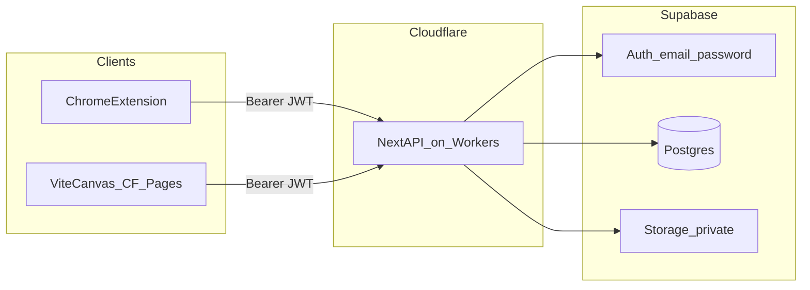

# Atelier hosted stack: Cloudflare Workers + Supabase

Date: 2026-11-19  
Status: Approved for planning (single-user)

## Goal

Host Atelier so the canvas app, Next.js API, and Chrome extension work against a real backend with email/password auth — for the owner only. Hosted library starts empty (no PGlite import).

## Decisions (locked)

| Decision | Choice |
| --- | --- |
| Audience | Single user (owner only) |
| API runtime | Keep Next.js API on Cloudflare Workers (vinext first; OpenNext only if vinext cannot support required features) |
| Auth | Supabase email + password |
| Data | Fresh hosted library; no migration from local PGlite |
| Approach | Next API on Workers + Supabase Auth/Postgres/Storage + canvas on Pages + extension JWT |

## Architecture

- **API contract:** keep existing routes under `app/api/` (`projects`, `saves`, `board`, `assets`, `search`, `health`).
- **Canvas:** Vite app on Cloudflare Pages; API base URL via env (hosted Workers URL).
- **Supabase:** Auth + Postgres + private Storage.
- **Extension:** talks only to the API, never to the canvas UI.
- **Source of truth:** hosted is authoritative once live. Local PGlite may remain briefly for offline hacking, then converge on Supabase for local too so two DB backends are not maintained long-term.

## Auth and extension

- Supabase email + password for v1.
- Owner allowlist: env `ATELIER_OWNER_EMAIL`; API rejects authenticated users who are not the owner.
- Canvas: sign-in → Supabase session → `Authorization: Bearer <access_token>` on API calls (same header shape as today’s shared token, JWT instead of `ATELIER_TOKEN`).
- Extension popup: replace Server URL + Access token with Email + Password. Production API URL is the default Server; still overridable for local/preview. On sign-in: `signInWithPassword` → store access + refresh tokens in `chrome.storage.local` → refresh when expired. Sign-out clears session.
- Assets: no `?token=` query auth on hosted. Mutating API calls use Bearer JWT; preview/download uses short-lived signed Storage URLs issued by the API. Private bucket only.
- Extension `host_permissions` include the production API origin; optional host permission remains for preview/local URLs.

## Data and jobs

- Port schema from backend `lib/db.ts` (`save`, `asset`, `segment`, `board`, `board_item`, projects) into Supabase SQL migrations.
- Every row has `owner_id`; RLS enforces `auth.uid() = owner_id`. Service role used only where required (e.g. privileged server paths); prefer user JWT otherwise.
- `asset.storage_path` is a Supabase Storage object key, not a filesystem path. Upload/download via API or signed URLs.
- Remove Workers blockers from the hosted path: no PGlite disk, no Node `fs` for assets, no `sharp`. Image prep for Jev: send JPEG/PNG/WebP within Jev size limits first; add a Workers-safe resize step only if rejects force it.
- Jobs: replace in-process `globalThis` queue with `waitUntil(processSave)` on save for v1. Add a Cloudflare cron Trigger to requeue stuck `processing`/`accepted` rows if needed. Escalate to Cloudflare Queues only if waitUntil drops work in practice. Preserve status machine: `accepted → processing → ready|failed`.
- Search: keep hybrid keyword + Jev visual tags; Postgres FTS on Supabase. Embeddings remain optional/stub.
- No import of existing local library.

## Deploy and environment

- Cloudflare Workers: Next API (vinext first).
- Cloudflare Pages: Vite canvas.
- Start on `*.workers.dev` / `*.pages.dev`; custom domain later optional.
- Supabase: one project. Workers secrets/env: `SUPABASE_URL`, `SUPABASE_ANON_KEY`, `SUPABASE_SERVICE_ROLE_KEY`, `ATELIER_OWNER_EMAIL`, optional `TYPESAFE_API_KEY`. Never commit secrets.
- Extension remains sideloaded (Chrome Web Store out of scope).

### Smoke path

1. Create owner user in Supabase Auth (email matches `ATELIER_OWNER_EMAIL`).
2. Sign in on canvas → create/open board.
3. Sign in on extension → save one page.
4. Item appears on board; search finds it (tags if `TYPESAFE_API_KEY` set).

## Out of scope

- Multi-user / public signup
- OAuth (Google/GitHub)
- Chrome Web Store publish
- Migrating local PGlite data
- Embeddings / full semantic index beyond current Jev tagging + FTS
- Custom domain (optional later)

## Success criteria

- Owner can sign in on canvas and extension with email/password.
- Non-owner JWT cannot read or write data.
- Save → process → ready works on hosted Workers against Supabase.
- Extension default target is the hosted API; local override still works.
- Canvas on Pages talks to the hosted API end-to-end.

## Implementation notes (for planning)

Primary code lives in worktrees:

- Backend/extension: `.claude/worktrees/orchestration-browser-extension-f8ab55` (branch `claude/orchestration-browser-extension-f8ab55`)
- Canvas: `.claude/worktrees/infinite-canvas-frontend-4a2f39` (branch `claude/infinite-canvas-frontend-4a2f39`)

Key touch points today: `lib/auth.ts`, `lib/db.ts`, `lib/assets.ts`, `lib/jobs.ts`, `lib/search/image.ts`, extension popup/`signin.ts`/`settings.ts`, canvas `api/client.ts` + Vite proxy.
